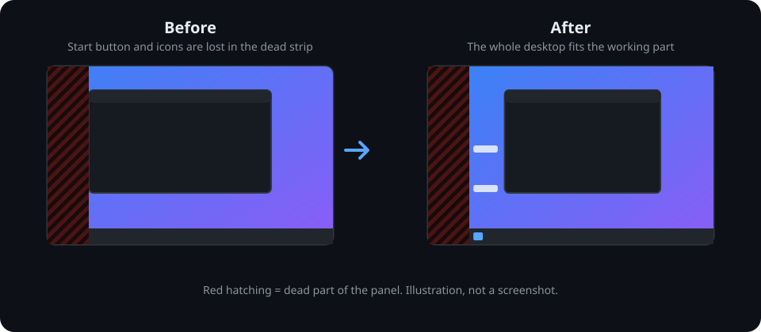
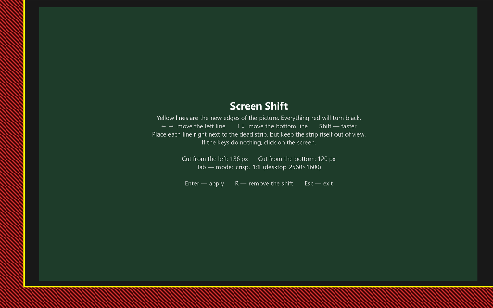

# ScreenShift — 屏幕损坏四边裁切 / Four-edge desktop adjustment for damaged screens

**屏幕边缘坏了、出现黑条，导致任务栏或窗口被挡住？** 本 fork 为 ScreenShift 增加四边独立裁切，把完整 Windows 桌面放进屏幕仍可用的矩形区域。它是屏幕损坏后的软件应对方法，不会修复液晶面板；需要 Windows 10+、一个活动显示器及兼容的显卡驱动。

**Damaged laptop screen or dead strips hiding your taskbar and windows?** This ScreenShift fork adds independent left, top, right and bottom adjustments to fit the Windows desktop into the working rectangle of your display. It is a software workaround, not a physical panel repair. Requires Windows 10+, one active display and a compatible GPU driver.

**项目地址 / Project:** [wangcanhao-cmd/ScreenShift](https://github.com/wangcanhao-cmd/ScreenShift) · **上游贡献 / Contribution:** [PR #1](https://github.com/Bluremind/ScreenShift/pull/1)

[中文](#中文) | [English](#english)

<a id="中文"></a>

本仓库是 [Bluremind/ScreenShift](https://github.com/Bluremind/ScreenShift) 的 fork，增加 **左、上、右、下四个边界独立调整**，用于将完整 Windows 桌面放到损坏屏幕仍可用的矩形区域内。原作者：Bluremind；原版权声明和许可证保持不变。

> 本版本界面支持中文、英语、日语、韩语和俄语，可在 Language 下拉框即时切换。下方保留的原项目介绍、截图和官方下载链接描述的是上游版本；上游 EXE 不包含本 fork 的四边修改。本 fork 目前没有发布修改版 EXE。

## v1.6.2：修复竖屏启动错误 1610 / Fix portrait startup error 1610

修正 v1.6.1 遗漏的底层坐标转换：界面使用旋转后的尺寸，CCD 源尺寸、路径源尺寸和裁切矩形使用旋转前坐标；读写时进行双向转换。避免将正常竖屏误判为已裁切，从而在打开窗口前提交无效的恢复配置。四方向测试增加底层字节布局断言；本机 AMD 780M 的 90° 竖屏全屏配置与 13 个系统模式在测试裁切区域均通过 SDC_VALIDATE（未应用显示设置）。实际裁切位置仍需目视确认。

Fixes the incomplete v1.6.1 portrait conversion. UI geometry uses rotated coordinates, while CCD source dimensions, path-source dimensions and image regions use pre-rotation coordinates. Bidirectional conversion prevents normal portrait output from being mistaken for an existing crop and rejected during startup reset. Tests now assert raw geometry for all four rotations. On this AMD 780M system at 90°, the identity configuration and all 13 enumerated modes passed SDC_VALIDATE for a sample crop, without applying display changes. Visual placement still requires confirmation.

## v1.6.1：竖屏坐标修正 / Portrait coordinate fix

修正 90° / 270° 旋转时仍使用物理信号宽高的问题：窗口、裁切和恢复现在使用旋转后的桌面尺寸，同时保留显示器信号时序和系统旋转方向。竖屏比例标签支持约 9:16 等。请先关闭校准窗口，在 Windows 设置方向后重新打开程序，再调整四边；已有裁切数值不会自动映射到旋转后的坏边位置。四方向坐标回归测试通过，实际竖屏显示仍需在对应硬件上确认。

For 90° / 270° rotation, calibration, crop placement and reset now use rotated desktop dimensions while preserving target signal timings and rotation. Portrait ratio labels include approximate 9:16. Close calibration before changing orientation in Windows, then reopen and adjust the edges. Saved cuts are not automatically remapped to the rotated damaged edges. Geometry tests cover all four rotations; actual portrait output still needs hardware verification.

## v1.6.0：先验证可用性，再筛选比例 / Validate first, then filter by aspect ratio

本节取代下方 v1.3–v1.5 的分辨率列表说明。旧版先筛选比例，把未经支持的超宽测试预设当成候选，可能留下全部无法应用的选项；现已修正。

启用 **Compatible resolution for area (D) / 按选区选择兼容分辨率** 后：

1. 使用 `EnumDisplaySettingsEx` 读取当前显示设备与显示器兼容的系统模式。
2. 对每个分辨率计算在当前选区内等比例居中的输出矩形，调用纯 `SDC_VALIDATE` 验证，不应用设置。
3. 仅在验证成功的模式中找最接近选区的比例组，保留组内所有尺寸。
4. 每项标注约分后的比例和已验证状态，如 `1024×768 — 4:3`、`1280×1024 — 5:4`、`1920×1080 — 16:9`。整数像素导致的近似比例显示 `≈`，如 `1366×768 — ≈16:9`。
5. 改变边界会重新验证；语言切换等不改变选区的操作复用结果。旧设置中不可用的选择自动替换为本组选项中宽度最接近的模式。无验证通过的模式时列表禁用并提示，不提供猜测的候选。

不再提供硬编码超宽测试预设或任意生成的尺寸。系统只有某个小尺寸模式最接近选区时，列表可能只剩该模式，这是当前驱动能力的反映。验证通过说明 Windows 当时接受该配置，并非保证真实切换绝不会失败；应用前会再次验证，且保留 20 秒确认恢复。

**English:** This supersedes the resolution-list behavior described in v1.3–v1.5 below. The app now enumerates monitor-compatible system modes with `EnumDisplaySettingsEx`, validates each mode together with its proportional output rectangle using `SDC_VALIDATE`, and only then selects the closest aspect family among successful results. It retains all sizes in that family. Labels show reduced ratios (4:3, 5:4, 16:9, etc.); approximately matching integer-pixel ratios use `≈`. No hardcoded ultrawide presets or guessed sizes appear in the dropdown. Area changes trigger fresh validation; unchanged areas reuse cached results. Unsupported saved choices resolve to the nearest available width. If no mode passes, the list is disabled with an explanation. Validation is repeated before applying and the 20-second confirmation remains.

系统报告的是具体模式，不是一张独立的“合法比例”表。GPU 缩放能将桌面分辨率映射到屏幕的原生输出，但它仍依赖驱动接受的源分辨率和路径配置；本程序已经通过 Windows 显示配置接口使用这条缩放／放置路径，并没有实现独立的虚拟显示驱动。

The system reports concrete modes, not a standalone list of legal aspect ratios. GPU scaling maps a desktop source resolution to the panel output, but still depends on accepted source modes and display-path configurations. ScreenShift already uses the Windows display configuration scaling/placement path; it does not implement its own virtual display driver.

## v1.5.1：按选区比例筛选 / Filter by selection aspect ratio

固定分辨率（驱动模式及超宽测试预设）只显示最接近选区比例的一组，同组不同分辨率全部保留。使用约 0.2% 的容差容纳整数取整差异，例如 1366×768 与 16:9。原生自动尺寸和按当前选区计算的自定义尺寸继续保留。调整边界时实时刷新列表；当前固定选项被过滤后回到 1:1 自动尺寸。兼容替代方案也优先限制为驱动模式中最接近的比例组。

Fixed driver and ultrawide presets are filtered to the closest aspect-ratio family, retaining all sizes within that family. A 0.2% tolerance accommodates integer-rounded variants such as 1366×768. Native auto and selection-derived custom resolutions remain available. The list refreshes as boundaries move; a filtered-out selection resets to native auto. Compatibility alternatives are restricted to the closest driver aspect family. Filtering does not make an unsupported mode supported.

## v1.5.0：超宽屏测试预设 / Ultrawide test presets

语言顺序为 **English → 简体中文 → Русский → 日本語 → 한국어**。启用选区分辨率后，下拉列表新增以下固定尺寸；每行中的尺寸具有完全相同的比例：

| 比例 / Exact ratio | 分辨率 / Resolutions |
| --- | --- |
| 64:27 | 1280×540、1920×810、2560×1080 |
| 43:18 | 1720×720、2580×1080、3440×1440 |
| 32:9 | 1920×540、2560×720、3840×1080、5120×1440 |

2560×1080 和 3440×1440 常被统称为 21:9，但实际比例略有不同，因此低分辨率预设分成两组。下拉列表可以滚动，**F6** 打开后用方向键或 End 浏览，不以 1920 为上限。

除非驱动确实枚举了相同尺寸，否则这些选项标记为“超宽测试”，不是保证支持的模式。应用前仍由 Windows 验证，失败时提供经过验证的替代方案；不会直接修改显示器 EDID 或安装驱动。画面保持所选桌面的比例，居中放入裁切区域，区域比例不匹配时可能留边。真正应用的效果需要在目标显卡上确认。

**English:** The language order is English, Simplified Chinese, Russian, Japanese, Korean. The resolution dropdown now includes the fixed ultrawide presets above, with exact-ratio lower-resolution variants in each row. The two commonly named 21:9 families have slightly different exact ratios. Scroll the dropdown (F6, arrow keys, End) to see all choices. Presets are labelled as ultrawide tests unless enumerated by the driver. Windows validates them before applying; driver support is not guaranteed. They preserve desktop proportions within the selected rectangle and may leave margins when its ratio differs. No EDID or driver changes are made.

## v1.4.0：驱动兼容模式与五种语言 / Driver compatibility and five languages

**非标准比例被 Windows 拒绝的原因：** 按选区比例计算出的分辨率（如 1620×880、1920×1043）不一定被显卡驱动支持。尺寸计算正确不代表 Windows 能应用它。本机只读诊断中这些自定义模式返回错误码 31，而枚举出的标准模式通过验证。

分辨率列表现在区分 **自定义** 和 **驱动模式**。自定义模式验证失败时，程序按比例和大小挑选驱动模式，逐个调用 `SDC_VALIDATE`；找到通过验证的方案后，先询问是否尝试，再临时应用并等待 20 秒确认。拒绝替代方案不会应用它。未找到兼容方案时，会显示失败阶段、错误码、分辨率、选区及 Windows 错误描述，并写入 `%LOCALAPPDATA%\ScreenShift\last-error.txt`。

**驱动模式保持画面比例，在所选区域内居中显示，可能留黑边。** 对于驱动不支持的任意比例，不能保证“正常比例、不留黑边、任意分辨率”三者同时成立。不会自动改回拉伸模式，也不使用允许系统任意调整模式的标志。

说明区域上方新增 **Language / 语言** 下拉框（快捷键 **F7**）：English、简体中文、Русский、日本語、한국어。选中后即时更新说明、选项和确认对话框，独立保存于 `%LOCALAPPDATA%\ScreenShift\language.txt`。命令行 `--lang=en|zh|ja|ko|ru` 可覆盖本次启动语言；旧的显示配置保持兼容。源码翻译表位于 `UiText.cs`。

**English:** Custom resolutions derived from a selection may be rejected by the GPU driver even when their geometry is correct. The dropdown now labels custom and driver-enumerated resolutions separately. On validation failure, the app ranks driver modes by aspect ratio and size and validates candidates without applying them. It asks before trying a validated alternative, then retains the 20-second keep/revert trial. Driver modes preserve proportions and may leave margins inside the selected region. Exact arbitrary aspect ratios without margins cannot be guaranteed on unsupported hardware.

Failures now report the stage, numeric error code, desktop size, output rectangle and Windows error text. Details are saved to `%LOCALAPPDATA%\ScreenShift\last-error.txt`. The new **Language** dropdown (**F7**) switches English, Simplified Chinese, Japanese, Korean and Russian immediately and saves the choice independently in `language.txt`. Use `--lang=en|zh|ja|ko|ru` for a launch-time override. Translations live in `UiText.cs`.

Additional checks / 附加检查：

```powershell
powershell -NoProfile -ExecutionPolicy Bypass -File .\tests\compatibility-language.ps1
# Queries and validates sample configurations only; never applies or saves display changes.
powershell -NoProfile -ExecutionPolicy Bypass -File .\tests\diagnose-display.ps1
```

Driver choices are stored as `width * 10000 + height` in the last settings field; select them through the UI instead of editing this value manually. Existing width-only choices and old settings remain readable.

## v1.3.0：按选区比例调整分辨率 / Desktop resolution matching the selected area

新增 **Match desktop to selected area (D)** 复选框，勾选后改变 Windows 的桌面分辨率，并铺满四边选定区域。与上一版拉伸不同，桌面本身采用选区比例，应用可以按新的宽屏或竖屏桌面重新布局。

- 默认关闭，兼容已有设置；按 **D** 开关。
- 旁边下拉框默认 **1:1, auto**：桌面分辨率等于可用区域的实际像素，避免缩放。
- 另提供以 960、1280、1366、1600、1920、2560、3840 为宽度的选项，高度由选区比例计算。按 **F6** 可打开下拉框；列表获得焦点时方向键选择分辨率，点击背景后恢复边界调整。
- 修改裁切边界时，保留所选宽度并自动更新高度。由于像素必须为整数，高度按最近整数取整。
- 例如可用区为 1620×880 时，可以选择 1620×880（1:1）、1366×742、1920×1043；不会用 1920×1080 强行改变选区比例。16:9 区域则会提供 1920×1080。
- 更高桌面分辨率通常能容纳更多内容，但显示的字和控件更小；较低分辨率则更大，实际也受 Windows DPI 设置影响。
- 此模式优先于 Crisp/Fill，“保持原始比例”复选框禁用；取消后恢复原模式和比例偏好。
- 显卡驱动可能拒绝自定义尺寸。应用前仍进行系统验证，应用后必须在 20 秒内确认；未确认会恢复之前的显示设置。

**English:** Enable **Match desktop to selected area (D)** to change the actual Windows desktop resolution to the selected rectangle's aspect ratio and fill that rectangle. This lets applications lay out against the new desktop shape instead of stretching the original desktop. The adjacent dropdown offers the native usable size (**1:1, auto**) and widths of 960/1280/1366/1600/1920/2560/3840 with automatically calculated heights, rounded to integer pixels. For a 1620×880 area, examples include 1366×742 and 1920×1043; a 16:9 area offers 1920×1080. Higher resolutions generally fit more content with smaller text; Windows DPI settings also affect sizing.

Press **D** to toggle and **F6** to open the resolution dropdown. Arrow keys navigate the focused dropdown; click the background to resume boundary adjustment. Resizing the selection updates the resolution heights while retaining the chosen width. Area-resolution mode overrides Crisp/Fill and disables the original-aspect checkbox. Unchecking restores the previous mode. Driver support for custom resolutions varies; system validation and the 20-second confirmation/revert still apply.

新配置 / New settings: `left top right bottom crisp|fill aspect|stretch area|original width`。例如 / Example: `100 50 200 150 fill aspect area 1920`。`width=0` 自动使用选区原生尺寸 / uses the native usable size. 三项、五项和六项旧配置均兼容，默认不开启此模式 / Legacy three-, five- and six-value settings keep this mode disabled.

## v1.2.0：可选保持比例 / Optional aspect ratio

校准界面底部新增 **Keep original aspect ratio** 复选框，默认勾选。Fill 模式下取消勾选可铺满四边选定的区域；按 **A** 也可切换。选项随设置保存。Crisp 保持 1:1 显示，此选项在 Crisp 下禁用，切回 Fill 后恢复之前选择。

例如 1920×1080 屏幕裁掉左 100、上 50、右 200、下 150 后，取消保持比例会将整个桌面拉伸到 `(100, 50)` 起始的 **1620×880** 区域。它增加的是实际利用的屏幕面积，不会增加桌面分辨率，文字、圆形和图片可能变形。Enter 应用后的 20 秒确认／恢复机制仍然保留；实际效果取决于显卡驱动。

The calibration overlay now has a **Keep original aspect ratio** checkbox, enabled by default. In Fill mode, uncheck it (or press **A**) to stretch the entire desktop into the selected rectangle. The preference is saved. Crisp remains pixel-for-pixel and disables the checkbox; switching back to Fill restores the saved preference. Stretch uses more of the physical panel but does not increase desktop resolution and may distort text and images. The 20-second apply confirmation/revert remains in place; actual driver acceptance requires hardware testing.

## 本版本的改动

- 四边裁切计算、四条边界预览、四边像素数显示及配置保存。
- 兼容原来的三项配置，读取时将上、右裁切设为 0。
- 支持 1 像素微调；取消每边最多裁切三分之一的限制。
- 校准界面保留至少 640×360 的可用区域；屏幕某维度更小时保留该维度全长。
- 保留应用后 20 秒内确认、超时恢复和手动重置功能。

## 操作方法

| 按键 | 操作 |
| --- | --- |
| ← / → | 移动左边界 |
| ↑ / ↓ | 移动下边界 |
| Ctrl + ← / → | 移动右边界 |
| Ctrl + ↑ / ↓ | 移动上边界 |
| Shift + 上述移动按键 | 每次 20 像素（默认 4 像素） |
| Alt + 上述移动按键 | 每次 1 像素 |
| Tab | 切换 Crisp / Fill |
| Enter | 应用；20 秒内点击 Keep 保存，否则恢复 |
| R | 移除裁切并删除保存配置 |
| Esc | 取消校准 |

边界按箭头方向移动。Crisp 在可用区域内居中放置能容纳的最大标准分辨率，按 1:1 显示；Fill 默认保持原屏幕比例缩放；取消勾选 Keep original aspect ratio 可拉伸铺满所选区域，但画面比例会改变。仅支持矩形区域和一个活动显示器，实际可用性取决于显卡驱动。

## 从源码编译

使用 Windows 的 .NET Framework 4.x C# 编译器，无需安装 Visual Studio、.NET SDK 或 NuGet 包。在仓库目录执行：

```powershell
powershell -NoProfile -ExecutionPolicy Bypass -File .\build.ps1
.\dist\ScreenShift.exe
```

输出文件为 `dist\ScreenShift.exe`。验证几何计算、边界快捷键和预览绘制：

```powershell
powershell -NoProfile -ExecutionPolicy Bypass -File .\tests\four-edges.ps1
```

这些检查不会改变显示设置。实际显卡应用与超时恢复流程需要在目标设备上交互验证。

## 保存配置

文件位置：`%LOCALAPPDATA%\ScreenShift\settings.txt`。

当前格式详见 v1.3.0 说明。旧六项格式 `左 上 右 下 模式 比例选项`（例如 `100 50 200 150 fill stretch`）仍可读取。`aspect` 保持比例，`stretch` 拉伸铺满。旧的三项或五项格式仍兼容，默认保持比例。初次运行默认四边均为 0。

- `ScreenShift.exe --apply`：直接应用已保存配置，不显示确认窗口。
- `ScreenShift.exe --reset`：恢复完整屏幕并删除配置。
- 修改配置文件后建议先打开校准界面预览，再按 Enter 确认。

## 下载与许可

四边裁切功能已通过 [PR #1](https://github.com/Bluremind/ScreenShift/pull/1) 提交上游审查；提交不代表作者已批准或合并。

GitHub Releases 可以附加 EXE 供下载，和 Git 源码提交相互独立；`.gitignore` 忽略 `*.exe` 不影响 Release 附件。

但本项目的 [LICENSE](LICENSE) 第 3、4 条限制修改版分发和提供下载，需取得作者书面许可。本 fork 暂不提供修改版 EXE，先向上游提交功能贡献供审查。原作者的正式版本可从 [上游 Releases](https://github.com/Bluremind/ScreenShift/releases) 下载。公开源码不等于允许任意再分发，个人使用及其他用途请遵循原许可证。

---

<a id="english"></a>

## English — Four-edge calibration fork

This is a fork of [Bluremind/ScreenShift](https://github.com/Bluremind/ScreenShift) that adds **independent left, top, right and bottom boundaries**, so the entire Windows desktop can fit within the usable rectangular part of a damaged panel. Original author: Bluremind. The original copyright notices and license are retained.

The application UI supports English, Simplified Chinese, Japanese, Korean and Russian through the Language dropdown. The upstream introduction, screenshots and official download links below describe the upstream version; those binaries do not include this fork's changes. This fork has not published a modified executable release.

### Changes in this fork

- Four-edge region planning, four boundary previews, pixel readouts and saved settings.
- Backward compatibility with the original three-value settings; top and right default to zero when loading them.
- Optional 1-pixel adjustments and removal of the one-third-of-panel limit per edge.
- A minimum calibration area of 640 x 360 pixels, or the full panel dimension when that dimension is smaller.
- The existing 20-second confirmation, automatic revert and manual reset behavior is retained.

### Controls

| Keys | Action |
| --- | --- |
| Left / Right | Move the left boundary |
| Up / Down | Move the bottom boundary |
| Ctrl + Left / Right | Move the right boundary |
| Ctrl + Up / Down | Move the top boundary |
| Shift + movement | Move 20 pixels instead of the default 4 |
| Alt + movement | Move 1 pixel |
| Tab | Toggle Crisp / Fill |
| Enter | Apply; click Keep within 20 seconds, otherwise revert |
| R | Remove the shift and delete saved settings |
| Esc | Cancel calibration |

Boundaries move in the direction of the arrow. Crisp centers the largest fitting standard resolution with the panel's aspect ratio at 1:1 pixel size. Fill preserves proportions by default. Uncheck Keep original aspect ratio to stretch the desktop across the entire selected rectangle; this may distort text and images. Only rectangular regions and one active display are supported; actual compatibility depends on the GPU driver.

### Build and verify

Use the C# compiler included with Windows .NET Framework 4.x. Visual Studio, the modern .NET SDK and NuGet packages are not required. Run from the repository directory:

```powershell
powershell -NoProfile -ExecutionPolicy Bypass -File .\build.ps1
.\dist\ScreenShift.exe
```

The output is `dist\ScreenShift.exe`. Run the geometry, keyboard and preview checks with:

```powershell
powershell -NoProfile -ExecutionPolicy Bypass -File .\tests\four-edges.ps1
```

These checks do not change display settings. Actual GPU acceptance and interactive confirmation/revert require testing on the target device.

### Settings and commands

Settings are stored in `%LOCALAPPDATA%\ScreenShift\settings.txt`.

See v1.3.0 above for the current eight-value format. The previous six-value format `left top right bottom mode aspect-option`, for example `100 50 200 150 fill stretch`, is still accepted. Use `aspect` to preserve proportions or `stretch` to fill the selected rectangle. Legacy three- and five-value settings are accepted and default to preserving proportions. New configurations start with all four cuts at zero.

- `ScreenShift.exe --apply`: apply the saved settings directly without a confirmation dialog.
- `ScreenShift.exe --reset`: restore the full screen and delete saved settings.
- After editing settings manually, open calibration to preview them before pressing Enter.

### Downloads, contribution and permission

The four-edge implementation has been submitted upstream as [PR #1](https://github.com/Bluremind/ScreenShift/pull/1) for review. Submission does not mean the changes have been approved or merged.

GitHub Releases can host downloadable EXE attachments independently of Git source commits; ignoring `*.exe` in `.gitignore` does not prevent release attachments. However, sections 3 and 4 of the project's [LICENSE](LICENSE) restrict modified-version distribution and hosting downloads without the author's written permission. No modified executable release is offered here while permission is pending. Official upstream builds are available from [upstream Releases](https://github.com/Bluremind/ScreenShift/releases).

Public source availability does not grant unrestricted redistribution rights. Follow the original license for personal use and other uses.

[Back to Chinese / 返回中文](#中文)

---

## 签名与校验 / Signing and verification

本 fork 版本标识为 `1.6.0-four-edge`。普通构建输出未签名 EXE，并生成 `dist\ScreenShift.exe.sha256`；校验值用于核对文件，不代表安全认证。

**本机测试签名（Hao）：**

```powershell
powershell -NoProfile -ExecutionPolicy Bypass -File .\build.ps1
powershell -NoProfile -ExecutionPolicy Bypass -File .\self-sign.ps1 -Publisher Hao
```

测试文件位于 `dist\self-signed\ScreenShift.exe`。脚本在当前用户个人证书库中创建或复用一年有效的自签名代码签名证书，使用 SHA-256，私钥不可导出；不会安装受信任根证书。该版本没有可信时间戳，其他电脑默认不信任证书。Windows 可能显示 `UnknownError` / `NotTrusted` 和不受信任证书链提示。自签名不代表受信任发行版，不能消除 Gmail 的 EXE 附件限制。

**受信任证书签名：** 先取得代码签名证书、配置其私钥/硬件令牌并安装 Windows SDK Signing Tools。使用证书提供商的 RFC 3161 时间戳地址：

```powershell
# Replace every placeholder with your actual certificate/tool/provider values.
powershell -NoProfile -ExecutionPolicy Bypass -File .\build.ps1 -Sign -CertificateThumbprint "YOUR_40_HEX_THUMBPRINT" -SignToolPath "C:\path\to\signtool.exe" -TimestampUrl "https://YOUR_PROVIDER_TIMESTAMP_URL"
```

默认从 `CurrentUser\My` 选取证书；机器证书库使用 `-MachineStore`。脚本检查证书、执行 SHA-256 签名和时间戳、验证信任及签名者，成功后才写入校验文件。不要把私钥或密码提交到 Git。云签名服务需要对应服务配置，此脚本的证书库方式不自动配置云账号。

**English:** The fork is identified as `1.6.0-four-edge`. A normal build produces an unsigned EXE and SHA-256 checksum. `self-sign.ps1 -Publisher Hao` creates/reuses a one-year local development certificate with a non-exportable private key and signs a separate copy in `dist/self-signed`. It does not install a trusted root or add a trusted timestamp. An untrusted-chain result is expected; this is not a publicly trusted release.

For trusted signing, obtain a code-signing certificate, configure private-key access and install the Windows SDK Signing Tools. Run `build.ps1 -Sign` using the certificate thumbprint, SignTool path and your provider's RFC 3161 timestamp URL as shown above. The script validates the selected certificate, signs with SHA-256, timestamps, verifies the result, then writes the checksum. Cloud-signing accounts require provider-specific setup. Neither self-signing nor trusted signing bypasses Gmail's executable-attachment policy or guarantees SmartScreen reputation. Distribution still requires the author's permission.

Verify a file locally / 本地检查：

```powershell
Get-AuthenticodeSignature .\dist\self-signed\ScreenShift.exe | Format-List Status,StatusMessage,SignerCertificate
Get-FileHash .\dist\self-signed\ScreenShift.exe -Algorithm SHA256
```

## 上游项目介绍（保留原文） / Upstream introduction

<div align="center">

# ScreenShift

**Your laptop screen is partly dead? Put the whole Windows desktop back on the part that still works.**

A tiny tool, free for personal use, that moves and fits the *entire* desktop (wallpaper, icons, Start button, taskbar) into the working area of a damaged panel. No drivers. No installer. One 22 KB file, in English and Russian.

[](https://github.com/Bluremind/ScreenShift/releases/latest)
[](LICENSE)
[](COMMERCIAL.md)


[**Download**](https://github.com/Bluremind/ScreenShift/releases/latest) · [Русский](README.ru.md) · [How it works](#how-it-works) · [FAQ](#faq)



</div>

---

## The problem

A cracked corner, a failing display cable, a MacBook with the infamous "flexgate" dead strip, a panel that went black on one side. The laptop still works, but the edge of the picture is gone, and with it the **Start button, the leftmost desktop icons and half of every maximized window**.

Windows has no setting for "this part of my screen is dead". Moving windows around doesn't help, because the taskbar and the desktop still sit under the dead strip.

## The fix

ScreenShift asks Windows' display stack to draw the desktop inside a smaller rectangle of the panel. Everything is moved together, so nothing hides under the dead area. The dead strips simply stay black.

- **Everything fits.** Taskbar, Start button, icons, maximized windows.
- **Calibrate in 30 seconds.** Move four yellow lines with the arrow keys until they touch the dead strip.
- **Safe by design.** After applying, you have 20 seconds to press **Keep**. Do nothing and the old picture comes back on its own.
- **Remembers your setup.** Re-apply it any time with `ScreenShift.exe --apply`.
- **Two quality modes.** *Crisp* shows the desktop 1:1 at the largest standard resolution that fits. *Fill* uses the whole good area and scales the picture slightly.
- **English and Russian.** The interface follows your Windows language. Force one with `--lang=en` or `--lang=ru`.
- **Tiny and private.** One small exe, no installer, no network access, no telemetry. The code is a single readable C# file.

## Quick start

1. Download **`ScreenShift.exe`** from the [latest release](https://github.com/Bluremind/ScreenShift/releases/latest).
2. Run it. A calibration screen opens.
3. Use the arrow keys to move the **yellow lines** next to the dead strips. Hold **Shift** to move faster.
4. Press **Tab** to choose *Crisp* or *Fill*, then **Enter** to apply.
5. Press **Keep** within 20 seconds. Done.

<div align="center">

<br>
<sub>The calibration screen (rendered by the program itself, shown at half size). Yellow lines are the new edges of the picture.</sub>
</div>

> Windows may show a SmartScreen warning because the exe is not code-signed. See [Trust and verification](#trust-and-verification).

## Commands

| Command | What it does |
| --- | --- |
| `ScreenShift.exe` | Open calibration. Enter applies, R removes the shift, Esc exits. |
| `ScreenShift.exe --apply` | Re-apply the saved shift without asking. Handy for startup. |
| `ScreenShift.exe --reset` | Remove the shift and delete the saved settings. |
| `--lang=en` or `--lang=ru` | Add to any command to choose the interface language. |

Settings are stored in `%LOCALAPPDATA%\ScreenShift\settings.txt` as five values: left, top, right, bottom (pixels), and the mode (`fill` or `crisp`). Original three-value settings (left, bottom, mode) are still accepted, with top and right set to zero.

### Re-apply after every boot

Windows or the GPU driver can drop the shift after a restart, sleep or driver reset. To restore it automatically, put a shortcut to `ScreenShift.exe --apply` in your Startup folder (press `Win + R`, type `shell:startup`).

## How it works

ScreenShift uses the Windows display configuration API (`SetDisplayConfig`, virtual-mode aware). It keeps the physical panel mode and changes two things:

1. the size of the **desktop** Windows renders, and
2. the **rectangle on the panel** where that desktop is shown.

The GPU then scales or places the desktop into that rectangle in hardware. Windows itself believes it has a normal screen, so apps and the taskbar behave as usual. Calibration happens on an overlay that uses real panel pixels, so the lines you see are exactly where the picture will start.

## Compatibility

| | |
| --- | --- |
| **OS** | Windows 10 (version 1607 or newer) |
| **Runtime** | .NET Framework 4.x, which is already part of Windows 10 |
| **Displays** | One active display. With an external monitor connected, ScreenShift stops with a message and changes nothing. |
| **Tested on** | MacBook Pro (2016) running Windows 10 via Boot Camp, AMD Radeon Pro 460 |

Support for the virtual display modes depends on the GPU driver. If Windows rejects the mode, ScreenShift tells you and leaves your display unchanged. Reports from other hardware are very welcome, please open an issue.

## FAQ

**Does this fix the broken screen?**
No. It is a software workaround that makes a damaged screen usable. The dead strip stays dead. Replace the panel or cable when you can.

**Is it safe? Can I get stuck on a black screen?**
The change is applied as a trial. Without your confirmation it reverts after 20 seconds. If you ever need to undo it manually, run `ScreenShift.exe --reset`, or just reboot if you never pressed **Keep**.

**Will text look blurry?**
In *Crisp* mode the desktop is shown 1:1 at a standard resolution, so text stays sharp. *Fill* mode scales the picture by a few percent. Use Tab during calibration to compare.

**Why not just lower the resolution?**
A lower resolution is stretched across the whole panel, so the dead strip still eats part of the picture. ScreenShift decides *where* on the panel the picture goes.

**Why not AMD or NVIDIA scaling options?**
Those usually center the picture, which wastes good pixels on the opposite side, and are often missing for built-in laptop panels. ScreenShift lets you cut each side by exactly the amount you need.

**Is it free?**
Yes, for personal use: you, on your own computer, for your own private purposes. Everything else needs a paid commercial license: companies, freelancers, schools, charities and other organizations, work computers, and any service such as repairing other people's laptops. See [License](#license).

**Which languages does it speak?**
English and Russian. ScreenShift picks Russian when Windows is set to Russian and English otherwise. Use `--lang=en` or `--lang=ru` to override it. All texts live in one small `L.T("ru", "en")` table in the source, so adding another language is easy, see [Contributing](#contributing).

## Trust and verification

ScreenShift changes display settings, so you should be able to check what you run.

- The whole program is one file: [`ScreenShift.cs`](ScreenShift.cs), about 450 lines. It makes no network calls and writes only `settings.txt`.
- Build it yourself in seconds with the C# compiler that ships with Windows, no SDK needed:

  ```powershell
  powershell -NoProfile -ExecutionPolicy Bypass -File .\build.ps1
  ```

- The release page lists the **SHA-256** of the published exe.
- The exe is not code-signed, so SmartScreen may warn on first run. Choose *More info*, then *Run anyway*, or build from source.

## Contributing

Issues and pull requests are welcome. By submitting a contribution you agree that it is distributed under the project's [license](#license), including the commercial licenses offered by the author. Good first contributions:

- More interface languages (English and Russian are built in)
- Support for multiple displays
- Reports of which GPUs and laptops work
- An optional "start with Windows" switch

## License

| | |
| --- | --- |
| **Personal use** | **Free.** An individual, on their own computer, for their own private purposes, under the [ScreenShift Personal Use License](LICENSE). |
| **Everything else** | **Paid license.** Companies, freelancers, schools, charities and other organizations, work computers, any service, redistribution. See [COMMERCIAL.md](COMMERCIAL.md). |

The source code is public so you can read and verify it, but this is not an open-source license in the OSI sense.

**Contact for a commercial license:** [bluremind@gmail.com](mailto:bluremind@gmail.com?subject=ScreenShift%20commercial%20license) · [GitHub issues](https://github.com/Bluremind/ScreenShift/issues) for questions and bug reports.
<div align="center">

If ScreenShift saved your laptop, a ⭐ helps other people find it.

</div>

## Four-edge calibration (local modification)

All four edges can be adjusted independently. The usable area is rectangular;
Fill preserves the panel aspect ratio by default; uncheck Keep original aspect ratio to stretch across the entire selected rectangle.
Crisp centers the largest fitting standard resolution inside the selected area.

| Keys | Action |
| --- | --- |
| Left / Right | Move the left boundary |
| Up / Down | Move the bottom boundary |
| Ctrl + Left / Right | Move the right boundary |
| Ctrl + Up / Down | Move the top boundary |
| Shift + movement | Move 20 pixels instead of 4 |
| Alt + movement | Move 1 pixel |
| Tab | Toggle Crisp / Fill |
| Enter | Apply, then confirm Keep within 20 seconds |
| R / Esc | Reset / cancel |

Boundaries move in the direction of the arrow. Calibration retains at least
640 x 360 pixels (or the whole panel dimension if smaller) for the instructions.
There is no longer a one-third-of-panel limit on each edge.
New installations start with zero cuts. The example settings `100 50 200 150 fill`
exclude 100 pixels left, 50 top, 200 right, and 150 bottom. Editing the settings
file alone does not change the display; open calibration to preview and confirm.
The older screenshots above show the original two-edge UI.

Build and run the geometry/UI checks from the project directory:

```powershell
powershell -NoProfile -ExecutionPolicy Bypass -File .\build.ps1
powershell -NoProfile -ExecutionPolicy Bypass -File .\tests\four-edges.ps1
.\dist\ScreenShift.exe
```

The checks do not apply display configurations. Actual GPU acceptance and the
confirmation/revert flow must be checked interactively on the target display.