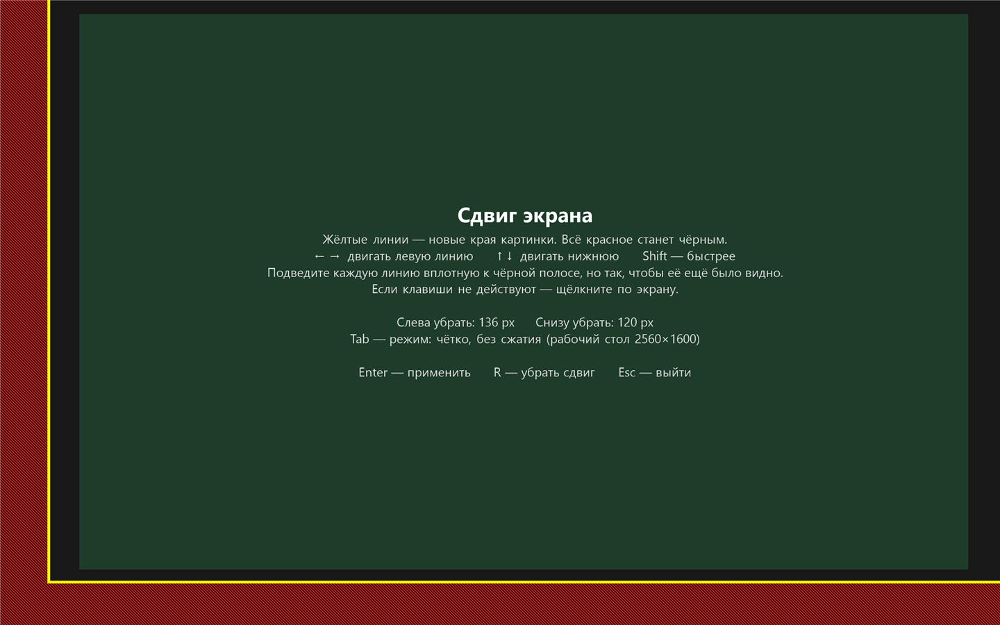

<div align="center">

# ScreenShift

**Часть экрана ноутбука не работает? Верните весь рабочий стол Windows на ту часть, что ещё показывает.**

Маленькая бесплатная утилита с открытым кодом. Она сдвигает и вписывает *весь* рабочий стол (обои, значки, кнопку «Пуск», панель задач) в рабочую область повреждённой матрицы. Без драйверов, без установщика, один файл на 22 КБ, интерфейс на русском и английском.

[](https://github.com/Bluremind/ScreenShift/releases/latest)
[](LICENSE)


[**Скачать**](https://github.com/Bluremind/ScreenShift/releases/latest) · [English](README.md) · [Как это работает](#как-это-работает) · [Вопросы и ответы](#вопросы-и-ответы)


</div>

---

## Проблема

Треснувший угол, умирающий шлейф дисплея, MacBook с «flexgate», матрица, которая почернела с одного края. Ноутбук работает, но край картинки пропал, а вместе с ним **кнопка «Пуск», левые значки рабочего стола и половина каждого развёрнутого окна**.

В Windows нет настройки «эта часть экрана не работает». Двигать окна бесполезно: панель задач и рабочий стол всё равно остаются под мёртвой полосой.

## Решение

ScreenShift просит графическую подсистему Windows рисовать рабочий стол в уменьшенном прямоугольнике матрицы. Всё двигается вместе, поэтому ничего не прячется под мёртвой зоной. Сами мёртвые полосы остаются чёрными.

- **Всё помещается.** Панель задач, «Пуск», значки, развёрнутые окна.
- **Настройка за 30 секунд.** Стрелками подведите две жёлтые линии к краю мёртвой полосы.
- **Безопасно.** После применения у вас 20 секунд, чтобы нажать **«Оставить»**. Если ничего не нажать, прежняя картинка вернётся сама.
- **Запоминает настройки.** Применить снова можно командой `ScreenShift.exe --apply`.
- **Два режима качества.** *Чётко* показывает стол один к одному в самом большом стандартном разрешении, которое помещается. *Вся картинка* использует всю рабочую область и немного сжимает изображение.
- **Русский и английский.** Язык интерфейса берётся из языка Windows. Задать вручную можно флагом `--lang=ru` или `--lang=en`.
- **Маленькая и приватная.** Один небольшой exe, без установки, без доступа в сеть, без телеметрии. Код умещается в один читаемый файл на C#.

## Быстрый старт

1. Скачайте **`ScreenShift.exe`** на странице [последнего релиза](https://github.com/Bluremind/ScreenShift/releases/latest).
2. Запустите. Откроется экран калибровки.
3. Стрелками подведите **жёлтые линии** к мёртвым полосам. С зажатым **Shift** линии двигаются быстрее.
4. Нажмите **Tab**, чтобы выбрать режим *Чётко* или *Вся картинка*, затем **Enter**.
5. Нажмите **«Оставить»** в течение 20 секунд. Готово.

<div align="center">

<br>
<sub>Экран калибровки (нарисован самой программой, показан в половину размера). Жёлтые линии — новые края картинки.</sub>
</div>

> Windows может показать предупреждение SmartScreen: exe не подписан цифровой подписью. См. [Доверие и проверка](#доверие-и-проверка).

## Команды

| Команда | Что делает |
| --- | --- |
| `ScreenShift.exe` | Открывает калибровку. Enter применяет, R убирает сдвиг, Esc выходит. |
| `ScreenShift.exe --apply` | Применяет сохранённый сдвиг без вопросов. Удобно для автозагрузки. |
| `ScreenShift.exe --reset` | Убирает сдвиг и удаляет сохранённые настройки. |
| `--lang=ru` или `--lang=en` | Добавляется к любой команде и задаёт язык интерфейса. |

Настройки лежат в `%LOCALAPPDATA%\ScreenShift\settings.txt` и состоят из трёх значений: сколько пикселей отрезано слева, сколько снизу и режим.

### Применять после каждой загрузки

После перезагрузки, сна или сброса драйвера видеокарты Windows может сбросить сдвиг. Чтобы он возвращался сам, положите ярлык на `ScreenShift.exe --apply` в папку автозагрузки (нажмите `Win + R`, введите `shell:startup`).

## Как это работает

ScreenShift использует программный интерфейс конфигурации дисплеев Windows (`SetDisplayConfig`, режим с поддержкой виртуальных режимов). Физический режим матрицы остаётся прежним, меняются две вещи:

1. размер **рабочего стола**, который рисует Windows;
2. **прямоугольник на матрице**, в котором этот стол показывается.

Дальше видеокарта аппаратно масштабирует или размещает стол в этом прямоугольнике. Windows считает, что у неё обычный экран, поэтому приложения и панель задач ведут себя как всегда. Калибровка идёт на наложении в реальных пикселях матрицы, поэтому линии стоят ровно там, где начнётся картинка.

## Совместимость

| | |
| --- | --- |
| **ОС** | Windows 10 (версия 1607 или новее) |
| **Среда** | .NET Framework 4.x, он уже есть в Windows 10 |
| **Экраны** | Один включённый экран. С внешним монитором ScreenShift покажет сообщение и ничего не изменит. |
| **Проверено на** | MacBook Pro (2016) с Windows 10 через Boot Camp, AMD Radeon Pro 460 |

Поддержка виртуальных режимов зависит от драйвера видеокарты. Если Windows не принимает режим, ScreenShift скажет об этом и оставит экран как был. Отчёты о работе на другом железе очень ценны, откройте issue.

## Вопросы и ответы

**Это чинит сломанный экран?**
Нет. Это программный обходной путь, который делает повреждённый экран пригодным для работы. Мёртвая полоса остаётся мёртвой. Когда сможете, замените матрицу или шлейф.

**Это безопасно? Можно остаться с чёрным экраном?**
Изменение применяется как пробное. Без вашего подтверждения оно откатится через 20 секунд. Если нужно отменить вручную, запустите `ScreenShift.exe --reset`. Если вы не нажимали **«Оставить»**, поможет и перезагрузка.

**Текст будет размытым?**
В режиме *Чётко* стол показывается один к одному в стандартном разрешении, и текст остаётся резким. Режим *Вся картинка* сжимает изображение на несколько процентов. Переключайтесь клавишей Tab во время калибровки и сравнивайте.

**Почему просто не снизить разрешение?**
Меньшее разрешение растягивается на всю матрицу, и мёртвая полоса по-прежнему съедает часть картинки. ScreenShift решает, *где именно* на матрице будет картинка.

**Почему не использовать масштабирование AMD или NVIDIA?**
Они обычно центрируют картинку и тратят хорошие пиксели с противоположной стороны. Для встроенных экранов ноутбуков этих опций часто вообще нет. ScreenShift позволяет отрезать каждую сторону ровно на нужную величину.

## Доверие и проверка

ScreenShift меняет настройки дисплея, поэтому вы вправе проверить, что запускаете.

- Вся программа в одном файле: [`ScreenShift.cs`](ScreenShift.cs), около 450 строк. Сетевых вызовов нет, пишет она только `settings.txt`.
- Соберите её сами за секунды компилятором C#, который идёт вместе с Windows. SDK не нужен:

  ```powershell
  powershell -NoProfile -ExecutionPolicy Bypass -File .\build.ps1
  ```

- На странице релиза указан **SHA-256** опубликованного exe.
- Exe не подписан цифровой подписью, поэтому при первом запуске SmartScreen может предупредить. Нажмите «Подробнее», затем «Выполнить в любом случае», или соберите из исходников.

## Участие в проекте

Issue и pull request приветствуются. С чего можно начать:

- другие языки интерфейса (русский и английский уже встроены)
- поддержка нескольких мониторов
- отчёты о том, на каких видеокартах и ноутбуках всё работает
- необязательный переключатель «запускать с Windows»

## Лицензия

[MIT](LICENSE). Бесплатно для личного и коммерческого использования.

<div align="center">

Если ScreenShift спас ваш ноутбук, звезда ⭐ поможет другим его найти.

</div>
